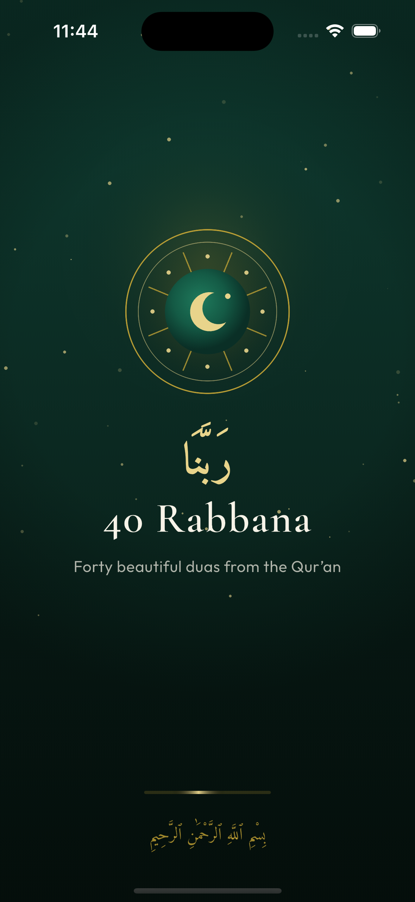
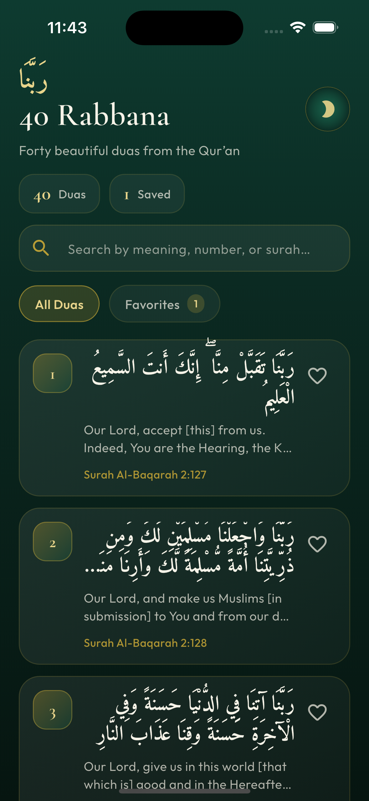
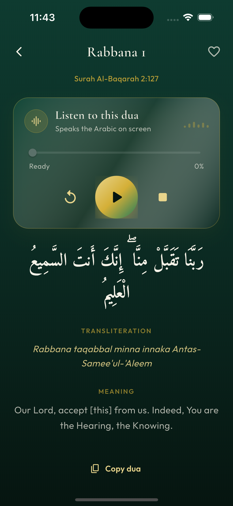

# 40 Rabbana

Forty beautiful duas from the Qur'an — a Flutter app built with GetX.

## Screenshots

<p align="center">
  
  &nbsp;&nbsp;
  
  &nbsp;&nbsp;
  
</p>

<p align="center">
  <b>Splash</b> &nbsp;·&nbsp; <b>Home</b> &nbsp;·&nbsp; <b>Dua detail</b>
</p>

## Features

- All 40 Rabbana duas with Arabic text, transliteration and English meaning
- Surah and ayah reference for each dua
- Listen to the Arabic recitation
- Search by meaning, number, or surah
- Save favorites
- Copy a dua to the clipboard
- Light and dark themes

## Getting Started

```bash
flutter pub get
flutter run
```
